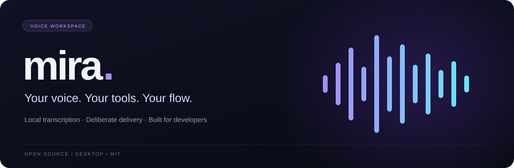
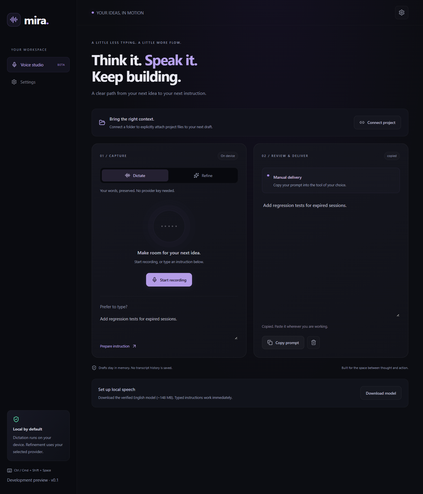
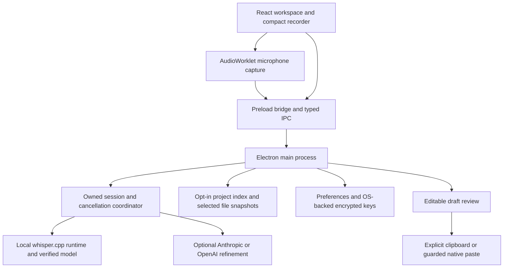

<div align="center">



[](https://github.com/Prarth314/Mira/actions/workflows/ci.yml)
[](https://github.com/Prarth314/Mira/actions/workflows/package.yml)
[](LICENSE)


**A voice workspace for developers.**<br>
Speak your intent. Preserve the details. Stay in your flow.

[Live website](https://mira-gilt-chi.vercel.app) · [Why Mira](#why-mira-exists) · [Workflow](#from-thought-to-reviewed-instruction) · [Get started](#get-started) · [Architecture](#architecture) · [Roadmap](#the-path-to-a-public-release) · [Contribute](#contributing)

</div>

---

Mira turns spoken developer instructions into editable drafts using local speech recognition. You can keep the original wording, optionally refine it through your own AI provider, attach selected project files, and deliberately copy or paste the result into another tool.

The core loop is **record → transcribe → inspect → deliver**. You stay responsible for the instruction and its destination at every step.

For a quick engineering review, see the [capability/evidence matrix](docs/ENGINEERING_EVIDENCE.md), [measured desktop results](docs/BENCHMARKS.md), and [five-minute demo](docs/DEMO.md). These distinguish implemented behavior, automated evidence, and remaining real-world validation.

> **Current status: unsigned internal beta, version 0.1.0.** Windows and macOS packaging and automated desktop checks are in place. Public signing, notarization, authenticated updates, broader native compatibility testing, and observed beta validation remain release gates. A successful CI run is evidence about the checks it ran, not a claim of universal production readiness.

## Why Mira exists

Developers often know what they want to change before they have written a good instruction for it. Explaining a bug aloud can be natural: describe the symptom, name the files, mention an edge case, and say what must remain unchanged. Turning that explanation into a useful prompt still takes work.

Ordinary dictation can capture the words while losing a filename or technical identifier. AI rewriting can make an instruction sound clearer while quietly changing its constraints. Moving the result between applications can interrupt concentration, and an accidental paste into the wrong input can be worse than having to type it yourself.

Mira brings those transitions into one desktop workspace:

- **Capture the thought while it is fresh.** Start from a microphone or a typed instruction without opening a separate chat conversation.
- **Keep technical detail visible.** Review the original instruction and resulting draft before using either. Refinement includes conservative checks for potentially lost technical terms and constraints.
- **Add context deliberately.** Select specific files and preview their contents instead of uploading a repository implicitly.
- **Use the tools you already work in.** Copy the finished prompt anywhere, or attempt a paste into a supported captured destination.
- **Keep the basic voice path local.** Dictation does not require an AI subscription, a provider key, or a Mira account.

The intended audience is developers who explain tasks to coding assistants, write issue descriptions, or prefer speaking a first draft. The product hypothesis is that a reviewable voice workflow can reduce the friction between an idea and a useful development instruction. That hypothesis still needs feedback from real users; this repository does not claim a measured productivity improvement.

## From thought to reviewed instruction



<sub>Actual development build with a synthetic example instruction.</sub>

For example, you might say:

> In `useStudio.ts`, fix cancellation while microphone permission is pending. A late permission response must release its stream without interrupting a newer recording. Keep the existing shortcut behavior.

Mira transcribes that instruction locally and prepares a draft. In **Dictate**, the wording stays faithful to the transcript. In **Refine**, your configured provider can restructure the instruction; Mira retains the original and falls back to it if processing fails or its checks detect likely detail loss. You inspect and edit the result before copying or delivering it.

### 1. Set up speech once

Packaged builds include the speech runtime. Use the workspace's setup control to download the pinned English model before recording. The model is approximately **148 MB**; setup exposes progress and cancellation and verifies the expected size and checksum.

In **Speech setup**, choose a microphone, explicitly check access, and refresh device/model status. The check stream is immediately stopped. Selection is saved locally for both workspace and compact recording. Permission recovery opens the OS microphone settings only when you choose it; shortcut conflicts have a workspace fallback.

Development builds need the separate runtime preparation command described below. After runtime and model setup, **Dictate can transcribe without a network connection**. Initial setup and optional cloud refinement require network access.

### 2. Choose how to prepare the instruction

| Mode | What happens | What you need |
| --- | --- | --- |
| **Dictate** | Local Whisper transcription produces an editable draft without cloud rewriting. Typed instructions can also be prepared. | Speech setup for recordings; no provider key. |
| **Refine** | The spoken or typed instruction is sent to your selected Anthropic or OpenAI provider for restructuring. | Your own provider key, network access, and any provider usage charges. |

Provider keys are configured in **Settings**. Mira does not load them from `.env.local`. There is no hosted Mira inference backend or account service in this build.

You can also record in Dictate, edit the draft, then choose **Refine reviewed text**. That sends only the reviewed instruction, keeps the original transcript, and retains reviewed text if the provider fails or the loss checks reject its output. Cancelling refinement leaves the previous draft available.

Refinement is a convenience, not a proof of semantic equivalence. The checks look for signs of lost filenames, identifiers, numbers, and negation; they cannot detect every change in meaning. Review the draft even when processing succeeds.

### 3. Attach only the context you intend to share

Connect a project folder, search its local filename index, and select up to **three files**. Mira reads and previews the selected text. Attachments are bounded to 24 KB per file and 24,000 characters in total.

The index respects Git-style ignore rules and excludes hidden paths, common credential files, generated directories, and symbolic links. Boundary checks prevent attachments from escaping the selected folder. These controls reduce accidental exposure; they do not establish that every allowed source file is free of secrets. Inspect the preview yourself.

Attached source is **not sent to the refinement provider**. It is appended as reference material when you explicitly copy or paste the prepared prompt. If a selected file changes, disappears, or becomes disconnected, reattach it and prepare the draft again before sharing.

Enable **Project-aware dictation** to suggest indexed filenames from spoken forms such as “use studio dot tee ess.” Suggestions appear in draft review; ambiguous names show multiple choices, and no replacement happens automatically. Accept a filename, keep the original, or undo the last correction. You can explicitly remember a pronunciation for that project and inspect, edit, or remove it under **Project pronunciations**.

Attach a JS/TS file while vocabulary is enabled to suggest its top-level declaration names too: “session t t l” can offer `sessionTTL`, with its source file shown. Use **Refresh index** after filenames change; refresh clears attachments so you can select current snapshots.

This version uses local filename/declaration matching and saved aliases after transcription; it does not train the speech model or send the vocabulary to a provider. A semantic symbol index, semantic search, and broader speech adaptation remain future work. See the [project-aware dictation guide](docs/PROJECT_AWARE_DICTATION.md) for the workflow and limits.

### 4. Review and choose delivery

Drafts remain editable. You can copy, discard, or explicitly attempt delivery when a supported destination was captured through the recording overlay. Workspace recordings and typed drafts use manual copy rather than inferring an external destination from the workspace itself.

| Shortcut | Action |
| --- | --- |
| **Ctrl / Cmd + Shift + Space** | Toggle the compact recorder. |
| **Ctrl / Cmd + Shift + M** | Show the full workspace. |

Native routing recognizes applications such as VS Code, Cursor, Claude Desktop, and supported terminals. It captures application identity, rechecks the target, and uses operating-system paste input. **It pastes into the target's focused input**; it does not reliably distinguish an AI chat field from an editor or a terminal agent from a shell.

Delivery is therefore reported as **attempted**, not confirmed receipt. An uncertain attempt is not automatically retried. Terminal delivery never presses Enter and rejects multiline text and control characters. Use manual copy when the target is unsupported, ambiguous, or unsuitable for automatic paste. The [beta checklist](docs/BETA_TESTING.md) tracks the real application testing still required.

## What is implemented today

| Area | Current behavior |
| --- | --- |
| Desktop experience | Full workspace, compact recorder, global shortcuts, tray, editable review, keyboard-accessible settings, and reduced-motion styling. |
| Speech | Local English transcription, bundled packaged runtime, explicit model setup, download verification, cancellation, and temporary-audio cleanup. |
| Recording lifecycle | Owned sessions, bounded audio buffering, pending-permission cancellation, stale-result guards, and a recording duration limit. |
| Optional refinement | Anthropic and OpenAI adapters, bounded retries and timeouts, cancellation, truncated-output rejection, and original-instruction fallback. |
| Project context | Opt-in filename indexing, scoped attachment previews, size limits, and checks for changed files before sharing. |
| Project-aware dictation | Opt-in local filename suggestions, explicit ambiguity review, undo, project-specific saved pronunciations, and changed-detail warnings. |
| Delivery | Explicit copy or guarded native paste attempts, destination revalidation, terminal restrictions, and no automatic submission. |
| Local state | OS-backed encrypted key storage, versioned preferences, atomic writes, explicit recovery, and key removal. |
| Diagnostics | On-demand report preview and copy using an allowlist that excludes instructions, keys, project paths, and source contents. |
| Distribution | Branded unsigned internal builds, packaged-app smoke checks, artifact checksums, and Windows CI install/uninstall exercises. |

The current interface does not expose autonomous shell execution, general computer control, screenshot capture, accounts, billing, or team administration. Direct editor extensions and public automatic updates are not implemented.

## Get started

### Visit the deployed website

The [Mira website](https://mira-gilt-chi.vercel.app) is live on Vercel and linked from this repository's GitHub About section. It currently serves the workspace UI as a browser preview. Local Whisper processing, secure key storage, project access, global shortcuts, and native delivery require the Electron desktop app; deploying the renderer does not make those capabilities available in a browser.

Use the website to explore the interface, and use an internal desktop build or the source instructions below for the complete workflow. Signed public desktop downloads remain a separate release gate.

### Try an internal packaged build

1. Open a successful run of the [Desktop packages workflow](https://github.com/Prarth314/Mira/actions/workflows/package.yml).
2. Download the artifact for your operating system. GitHub may require you to sign in; artifacts expire after **seven days**.
3. Extract the downloaded artifact. Windows includes an installer. macOS includes an inner application ZIP that must also be extracted to preserve the bundle's permissions and metadata.
4. Open Mira, complete model setup, and try **Dictate** before configuring optional refinement.
5. Review a short draft and copy it into a disposable document before testing native delivery.

Artifacts include `SHA256SUMS.txt` and `internal-build.json`. Checksums help detect corrupted downloads; they do not authenticate a publisher. These builds are unsigned, and operating systems can warn about or block them. Public signing and macOS notarization are still outstanding. See the [internal beta guide](docs/BETA_TESTING.md) for acceptance steps and build details.

### Run from source

Use **Node.js 24**, npm, and Git. The Node version is recorded in `.nvmrc`; use the committed lockfile through `npm ci`.

```bash
git clone https://github.com/Prarth314/Mira.git
cd Mira
npm ci
npm run prepare:speech
npm run dev
```

- **Windows x64:** runtime preparation downloads a pinned, checksum-verified upstream whisper.cpp CPU binary.
- **macOS:** runtime preparation builds pinned whisper.cpp source. Install CMake and the Xcode command-line tools first.
- **All recording paths:** download the model using the workspace setup control and grant microphone access when requested.

`npm run dev` builds Electron's main process and preload, starts Vite at `127.0.0.1:5173`, and launches Electron. Renderer changes use Vite's development workflow; restart the development command after main-process or preload changes.

### Platform scope

| Platform | Current evidence and scope |
| --- | --- |
| Windows x64 | Speech runtime preparation, internal installer packaging, automated desktop checks, and disposable CI install/run/uninstall coverage. Real microphone and destination testing remain necessary. |
| macOS | Pinned native speech build, internal application packaging, and automated desktop checks on the CI runner architecture. Signing, notarization, broader hardware coverage, and native acceptance remain outstanding. |
| Linux | Source lint, type, unit, and build checks run in CI. No supported native speech packaging or desktop distribution is promised. |
| Windows ARM64 / other architectures | Not a supported packaged target in the current runtime preparation path. |

On macOS, native application detection and paste routing require Accessibility authorization. Mira does not implicitly request it when recording starts; without it, use recording and manual copy. Microphone authorization is separate. OS permissions and global shortcut conflicts can affect behavior even when the application starts successfully.

## Architecture

Mira separates presentation from the capabilities that can read files, store secrets, invoke native processes, or contact providers.



### Why these boundaries matter

**Electron provides the desktop capabilities this workflow needs.** Global shortcuts, a compact overlay, microphone capture, clipboard access, native application identity, and OS-backed key storage need more than a static web page. The tradeoff is a larger application and a native security surface that must be maintained.

**The renderer has a narrow bridge.** It runs with context isolation, sandboxing, and Node integration disabled. Main-process handlers validate inputs, registered window identity, frame, URL, and window role. Permission handling permits explicit audio requests from trusted application content; camera and screen capture are denied in this build. Navigation and new windows are restricted.

**Sessions own their work.** A recording has an owner and identity, with cancellation propagated through capture, transcription, and refinement. Late microphone responses and old processing results must not alter a newer session. This is why lifecycle and cancellation behavior receive dedicated tests.

**Local speech and optional cloud refinement are separate stages.** Dictation remains useful without a provider key. Cloud failures preserve the original instruction, and project attachments do not silently become refinement input. The tradeoffs are an initial model download, local CPU use, and variable performance across hardware.

**Provider output becomes a draft.** It does not directly execute actions or send commands. Review and delivery are separate decisions, and simulated keyboard input is treated as an uncertain external side effect.

**Native dependencies are verified.** Speech preparation pins upstream archives and verifies checksums. Packaged runtime resources have a per-file hash manifest, and the model is pinned and verified. Packaged speech does not depend on an arbitrary executable found on the user's `PATH`.

### Repository map

```text
App.tsx                    Desktop workspace composition
components/                Recording, settings, context, and review UI
hooks/useStudio.ts         Renderer recording and session lifecycle
public/pcm-worklet.js      Microphone PCM conversion and final flush
src/types/                 Shared contracts and error types
src/main/                  Electron capabilities and policy boundaries
  studio.ts                Draft preparation, review, and delivery coordination
  session.ts               Session ownership and cancellation
  stt.ts                   Local speech runtime and model lifecycle
  project-index.ts         Scoped filename index and file snapshots
  dev-tool-router.ts       Guarded native destination adapters
  security.ts              Trusted-window and IPC checks
  keystore.ts              Encrypted provider-key persistence
scripts/                   Build, native preparation, and package verification
tests/                     Unit and Electron end-to-end coverage
docs/                      Roadmap, acceptance guidance, and evidence
.github/workflows/         Cross-platform checks and internal packaging
```

The UI uses React, TypeScript, Vite, and locally bundled Tailwind styling. Electron main and preload are compiled with esbuild. Vitest covers unit behavior; Playwright exercises the Electron application. The lockfile records exact dependency resolutions.

## Privacy and data flow

“Local transcription” describes the speech stage; it does not mean every optional workflow stays offline. The important boundary is what you choose to enable and share.

| Data | Where it goes and how it is retained |
| --- | --- |
| Microphone audio | Captured after recording starts, processed locally through a temporary WAV, and removed after processing. App-owned abandoned scratch directories are cleaned on startup. |
| Transcript and draft | Kept in memory. No transcript history is saved; closing the application loses unsaved drafts. |
| Instruction in Refine mode | Sent to the provider you select. That provider's terms, retention, and usage charges apply. |
| Connected project | Filenames are indexed locally in memory. Source contents are read for explicit attachments. Disconnect clears the active index and selection; existing draft snapshots remain until discarded or the app closes. |
| Project pronunciations | Saved only when explicitly requested, in the local app profile under a project-path hash. They contain the approved phrase and relative filename; remove them through Project pronunciations. |
| Attached source | Previewed locally and included in the prompt you explicitly copy or paste. It is not included in Mira's refinement request. |
| Provider keys | Persisted through Electron's OS-backed secure storage. Saved values are not returned through the renderer API. |
| Model setup | Contacts Hugging Face to obtain the pinned model. Development/build preparation fetches pinned upstream GitHub archives. |
| Diagnostics | Generated only on request from an allowlist; you preview and choose whether to copy or share the report. |

Mira does not upload analytics or crash reports in this build. Copy and paste use the system clipboard, whose history and synchronization are controlled by the operating system. Mira does not later restore an old clipboard value over something you copied yourself. Preferences and downloaded model weights remain in the application profile until removed through normal application/data management.

Read [PRIVACY.md](PRIVACY.md) for the current data-handling contract and [SECURITY.md](SECURITY.md) for sensitive reporting. Never include real keys, private transcripts, or confidential source in public issues.

## Development and verification

### Everyday commands

| Command | Purpose |
| --- | --- |
| `npm run dev` | Start the development workspace and Electron. |
| `npm run prepare:speech` | Prepare and verify the native speech runtime for the current supported platform. |
| `npm run lint` | Run ESLint. |
| `npm run typecheck` | Check TypeScript without emitting output. |
| `npm test` | Run unit tests once. |
| `npm run test:watch` | Run unit tests in watch mode. |
| `npm run format:check` | Verify source formatting. |
| `npm run format` | Format supported source files. |
| `npm run build` | Build Electron main/preload and the production renderer. |
| `npm run check` | Run lint, type checks, unit tests, and build. Formatting is checked separately. |
| `npm run test:e2e` | Build and exercise the Electron app through Playwright. |
| `npm run evaluate` | Run versioned offline synthetic policy fixtures; no audio or provider calls. |
| `npm run test:speech` | Explicitly run the public-sample Whisper smoke test. |
| `npm run test:performance` | Measure isolated startup, cancellation, indexing, memory and public-sample processing. |
| `npm run test:native` | Windows only: test the native adapter against an explicitly focused disposable target. |
| `npm run package:dir` | Prepare speech, build, and create an unpacked native application. |
| `npm run package` | Prepare speech, build, and create native distribution artifacts without publishing. |

Before proposing a change, run:

```bash
npm run check
npm run format:check
npm run test:e2e
```

Native packaging should be exercised on the target OS. Generated `dist`, `dist-electron`, `vendor`, `release`, and test-result outputs are not source contributions.

### What the tests establish

Unit tests cover boundaries such as session ownership, cancellation, bounded audio, refinement fallback, context scoping, settings recovery, and delivery policy. Desktop tests exercise the isolated preload, denied camera access, keyboard interaction, accessibility checks, editable drafts, context selection, synthetic microphone capture, and late permission responses.

CI checks lint, formatting, types, unit tests, and builds on Windows, macOS, and Linux. Desktop checks run on Windows and macOS. The separate packaging workflow exercises built applications, and Windows CI additionally installs, runs, and uninstalls its own application in a disposable runner directory.

Synthetic capture verifies the lifecycle, not real microphone quality. Automated accessibility checks do not replace screen-reader and keyboard testing by people. A successful paste command does not establish that a third-party application received text in the intended field.

### Opt-in real speech smoke test

An opt-in test uses the public upstream English speech sample and the actual local Whisper path. It downloads the model if needed and produces a benchmark report. In PowerShell:

```powershell
npm run prepare:speech
npm run test:speech
```

Optional measurement suites are separate from default CI and packaged smoke checks. They fail on an unsupported or improperly configured explicit invocation rather than appearing as skipped passes. See [evaluation definitions](docs/EVALUATION.md) and the [native acceptance matrix](docs/NATIVE_ACCEPTANCE.md).

The recorded [Windows public-sample benchmark](docs/benchmarks/windows-public-sample.json) measured 1,564 ms for model verification, transcription, and draft preparation on 11 seconds of audio. It is **one sample on one environment**, excluding recording time, optional cloud refinement, and delivery. It is not a general accuracy result or latency guarantee. See [beta acceptance](docs/BETA_TESTING.md) for the evaluation method and limitations.

## Troubleshooting

| Symptom | What to check |
| --- | --- |
| Recording cannot start | Finish model setup, check OS microphone permissions and the selected input device, then retry from the workspace. |
| Speech runtime is missing in development | Run `npm run prepare:speech`; on macOS, verify CMake and Xcode command-line tools are installed. |
| Model download fails or is cancelled | Check network access and free disk space, then retry setup. Partial downloads are cleaned; retries start again rather than resuming from an offset. |
| Refine fails or keeps the original | Check the selected provider, saved key, connectivity, and provider quota. Inspect the message; conservative detail checks may also keep the original. Dictate remains available without a provider. |
| No destination is available | Use manual copy. Workspace drafts intentionally have no external target; overlay detection can also fail or identify an unsupported application. |
| Native routing is unavailable on macOS | Check Accessibility authorization separately from microphone access. Manual copy remains available. |
| A shortcut does nothing | Another application or the OS may own the shortcut. Open the workspace directly and test recording there. |
| A selected file cannot be delivered | Reattach it and prepare again if it changed, was removed, or the project was disconnected. |
| Preferences cannot be read | Use the explicit recovery controls. Reset backs up preferences and preserves provider keys; avoid deleting the whole profile as a first step. |
| A packaged build triggers an OS warning | Internal artifacts are unsigned. Publisher signing and notarization are required before public stable distribution. |

For a reproducible issue, include the commit or build version, OS and architecture, steps, expected behavior, and actual behavior. Settings provides a diagnostic report that you can inspect before sharing. See [CONTRIBUTING.md](CONTRIBUTING.md).

## The path to a public release

The objective is a dependable, deployable desktop product with evidence behind its claims. The [production execution tracker](docs/production-roadmap.md) is the active source of release gates; historical research and plans are retained for context.

| Stage | What must be demonstrated |
| --- | --- |
| **Internal beta — current** | Reproducible builds, a usable local voice loop, explicit review, scoped context, cancellation, recovery, and packaged smoke coverage. |
| **Native validation** | Real microphones, permission denial/recovery, sleep/wake, focus changes, multiple displays, and each advertised OS/application combination pass the acceptance matrix. |
| **Measured product quality** | Held-out, consented speech evaluation; technical-token preservation; latency, memory, CPU, and battery baselines; assistive-technology testing; feedback from actual beta use. |
| **Release candidate** | Signed Windows distribution, macOS signing/notarization, verification of signed native resources, authenticated updates, settings migration, failed-update recovery, and upgrade/uninstall testing. |
| **Public release** | Resolve recurring beta defects, complete privacy and licensing review, add verified public desktop downloads to the deployed website, provide a support process, and establish a maintenance policy. |

Project-aware filename review and saved pronunciations are now implemented. The next capability investments are direct editor integration and evaluating vocabulary support on real developer tasks. Those should improve a proven voice workflow rather than expand the product into unrelated modes. Public signing needs publisher credentials, and user validation needs consenting testers; neither can be replaced by additional unit tests.

## Contributing

Useful contributions include a reproducible bug, an acceptance result with environment details, an accessibility improvement, a narrowly scoped reliability fix, or documentation that makes behavior easier to understand.

Start with [CONTRIBUTING.md](CONTRIBUTING.md), read the [roadmap](docs/production-roadmap.md), and keep changes small enough to review. Explain the user-visible problem, the resulting behavior, and the relevant verification. For native behavior, state exactly which platform and destination application you tested. Preserve original instructions and uncertain-delivery semantics when changing the pipeline.

For vulnerabilities or accidental exposure of sensitive information, follow [SECURITY.md](SECURITY.md) rather than opening a public issue containing private data.

### Documentation guide

| Document | Use it for |
| --- | --- |
| [Production roadmap](docs/production-roadmap.md) | Active milestones, evidence, and remaining release gates. |
| [Engineering evidence](docs/ENGINEERING_EVIDENCE.md) | Capability classifications, trust boundaries, tests, results, and limitations. |
| [Benchmarks](docs/BENCHMARKS.md) | Repeatable measurements, environment, sample counts, and boundaries. |
| [Evaluation](docs/EVALUATION.md) | Corpus format, matching/grading policies, and unmeasured cases. |
| [Native acceptance](docs/NATIVE_ACCEPTANCE.md) | Observed native cases and unperformed hardware/application checks. |
| [Demo and résumé guide](docs/DEMO.md) | Synthetic demonstration and evidence-limited portfolio claims. |
| [Beta testing](docs/BETA_TESTING.md) | Internal downloads, native acceptance cases, and evaluation guidance. |
| [Project-aware dictation](docs/PROJECT_AWARE_DICTATION.md) | Filename suggestions, local pronunciation management, and evaluation limits. |
| [Privacy](PRIVACY.md) | Current processing, sharing, and retention behavior. |
| [Security](SECURITY.md) | Sensitive reporting and security expectations. |
| [Contributing](CONTRIBUTING.md) | Development and collaboration guidance. |
| [Third-party notices](docs/THIRD_PARTY_NOTICES.md) | Upstream runtime, model, and dependency licensing context. |
| [Repository consolidation](docs/consolidation.md) | Why this repository is canonical and how the prototype histories were preserved. |

## Origins and license

Mira began as a collaborative hackathon prototype in [startupOS](https://github.com/aashrithtutuku02-stack/startupOS). Continued development is maintained by Prarth Gupta with the original teammates' permission. The [Mira-AI](https://github.com/Prarth314/Mira-AI) history and original team attribution are preserved here. The original prototype was a team effort; the [consolidation report](docs/consolidation.md) explains the repository history.

Mira is released under the [MIT License](LICENSE). Third-party components retain their own licenses; see the [third-party notices](docs/THIRD_PARTY_NOTICES.md).

---

<div align="center"><sub>Built for the space between a thought and a working instruction.</sub></div>
