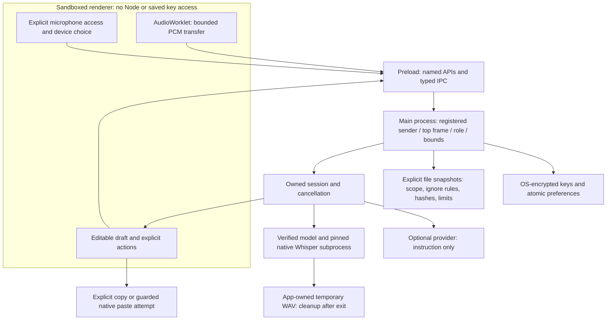

# Desktop engineering milestone

Evidence snapshot: November 1, 2026. This is an unsigned internal beta, not a public production certification. The maintained desktop rebuild is distinct from the earlier team prototype; attribution, MIT licensing, and repository history remain preserved in [consolidation](consolidation.md).

## What changed

- Completed speech setup: persistent microphone selection, explicit access check with immediate track release, permission recovery, model/runtime status, and visible shortcut conflicts.
- Added refinement of reviewed text while preserving the original and excluding attachments. Deadlines, cancellation, malformed output, provider failure, and conservative detail-loss fallback are tested.
- Cancelled owned work when the workspace hides, its renderer disappears, or a suspend event arrives. Track, listener, worklet, buffer, timer, and subprocess cleanup have targeted tests.
- Added an explicit workspace-only cancellation action for compact-recorder sessions, so keyboard users can open the workspace and cancel; stale IDs cannot cancel a replacement session.
- Fixed stale model-download promises that prevented repair, confined partial downloads to verified app storage, and cleaned only owned abandoned partial files after restart.
- Added conservative preservation checks for command flags, full versions, signed numbers and unchanged constraints; terminal paste rejects Unicode line/control separators.
- Adopted a measured CPU-only macOS beta baseline with processor-bounded native threads; see the scoped comparison in [benchmarks](BENCHMARKS.md).
- Restricted production CSP independently of development HMR, validated native process identifiers, and replaced raw native stderr with allowlisted recovery messages.
- Added explicit optional speech/native/performance suites and a versioned offline evaluation corpus. Default CI no longer reports optional skipped checks as part of a green desktop suite.

Existing Electron/React architecture, local Whisper, typed preload, scoped attachments, project vocabulary, encrypted keys, atomic preferences, reviewed delivery, and internal packaging were retained.

## Trust boundaries

Project contents do not become provider input implicitly. Native paste cannot establish which editor/chat field owns focus or acknowledge external receipt. File exclusions are defense in depth, not proof that source contains no secrets.

## Capability and evidence matrix

“Implemented/verified” means only the specific checks listed. “Implemented/unverified” identifies behavior that exists but lacks the corresponding real-world evidence. “Missing” and “blocked by external access” remain release work.

| Capability | Classification | Evidence | Limit |
| --- | --- | --- | --- |
| Speech setup and selected-device persistence | Implemented/verified | [Setup UI](../components/SpeechSetup.tsx), [settings/restart checks](../tests/e2e/recovery.spec.ts), [capture checks](../tests/e2e/capture.spec.ts) | Synthetic microphone; real device matrix unverified. |
| Local English inference without provider credentials | Implemented/verified | [Speech test](../tests/e2e/speech.spec.ts), [Windows measurements](benchmarks/windows-desktop-v1.json), [Windows packaged](benchmarks/windows-packaged-speech-v1.json), [macOS packaged](benchmarks/macos-packaged-speech-v1.json) | Public sample and clips, not representative accuracy. |
| Owned capture, pending permission, late stream, device/processor errors, hide/destroy/suspend | Implemented/verified | [Capture](../tests/e2e/capture.spec.ts), [session](../tests/unit/session.test.ts), [privileged orchestration](../tests/unit/studio-integration.test.ts) | Device loss, worklet errors and suspend are injected events, not physical hardware or actual sleep. |
| Native timeout/cancellation and temporary audio cleanup | Implemented/verified | [Real child processes](../tests/unit/speech-process.test.ts), [STT storage](../tests/unit/stt-lifecycle.test.ts), [scratch scope](../tests/unit/speech-scratch.test.ts) | Failure transport fixtures are separate from real Whisper sample inference. |
| Runtime/model verification and interrupted-download repair | Implemented/verified | [STT](../src/main/stt.ts), [failure cases](../tests/unit/stt-lifecycle.test.ts), real public-model setup | Synthetic corrupt/short/oversized streams; no offset-resume. |
| Reviewed refinement, fallback and attachment exclusion | Implemented/verified | [Refinement boundary](../src/main/refinement.ts), [policy tests](../tests/unit/refinement.test.ts), [main handlers](../tests/unit/studio-integration.test.ts), missing-key UI fallback | Provider transports mocked; no live API credits spent. |
| Live provider quality, rate limits and billing behavior | Implemented/unverified | [Evaluation procedure](EVALUATION.md) | Requires explicitly authorized credentials, bounded budget and human review. |
| Renderer isolation, sender/role validation, production CSP | Implemented/verified | [Security implementation](../src/main/security.ts), [actual IPC wrapper tests](../tests/unit/security.test.ts), [desktop assertions](../tests/e2e/desktop.spec.ts) | Does not replace independent security review. |
| Scoped files, ignores, symlinks, changed content, explicit previews | Implemented/verified | [Project tests](../tests/unit/project-index.test.ts), [desktop context](../tests/e2e/desktop.spec.ts) | Bounded index and snapshots, not complete secret detection or semantic indexing. |
| Encrypted keys and durable preferences | Implemented/verified | [Windows actual roundtrip](benchmarks/windows-desktop-contract-v1.json), [Windows CI](benchmarks/windows-ci-contract-v1.json), [macOS ARM64 CI](benchmarks/macos-ci-contract-v1.json), [keystore](../tests/unit/keystore.test.ts), [restart/migration/recovery](../tests/e2e/recovery.spec.ts) | Recorded Windows and macOS CI contracts report successful OS-encrypted roundtrips; other keychain configurations need manual coverage. |
| Explicit copy, uncertain paste, terminal controls, no duplicate retry | Implemented/verified | [Adapter policy](../tests/unit/delivery-policy.test.ts), [main orchestration](../tests/unit/studio-integration.test.ts), [Windows controlled fixture](benchmarks/windows-native-v1.json) | Disposable target was explicitly focused and given synthetic classification. Real editor/terminal certification remains unverified. |
| Keyboard prepare/copy, labels, contrast and dialog checks | Implemented/verified | [Desktop checks](../tests/e2e/desktop.spec.ts), automated axe checks | Not full screen-reader or assistive-device certification. |
| Installation and native packages | Implemented/verified for the recorded CI runs | [CI](https://github.com/Prarth314/Mira/actions/runs/41331722039), [packages](https://github.com/Prarth314/Mira/actions/runs/41331722381), [workflow](../.github/workflows/package.yml) | Consult actual run conclusion. Windows install/run/uninstall is disposable CI; macOS covers the available runner architecture. |
| Signed/notarized public installers | Blocked by external access | [Release gates](production-roadmap.md) | Publisher credentials unavailable; not configured or purchased. |
| Authenticated updater and failed-update rollback | Missing | Internal builds only | Preference recovery is not application-update rollback. |
| Real user benefit and broad compatibility | Blocked by external access | [Native acceptance](NATIVE_ACCEPTANCE.md), [beta feedback](BETA_TESTING.md) | Needs consenting participants and their actual workflows/hardware. |

The implementation/source check passed 170 unit tests across 29 files and three default Electron scenarios locally. CI checks each supported runner; the cited runs are the source of remote completion status. Optional native/speech/performance commands fail explicitly when improperly invoked rather than silently skipping.

## Measurements and remaining gates

See [methodology and results](BENCHMARKS.md), [evaluation definitions](EVALUATION.md), [native acceptance](NATIVE_ACCEPTANCE.md), and the [demo/résumé guide](DEMO.md). Numeric results are tied to their JSON source commit and environment, not extrapolated to users.

Remaining: real microphones and permission denial/recovery; actual sleep/wake and external application matrix; manual assistive-technology review; consented, independently reviewed speech corpus; live provider evaluation with a budget; signing/notarization; authenticated updates and update rollback; observed user usefulness. No users, productivity gains, broad accuracy, or public-release readiness are claimed.
