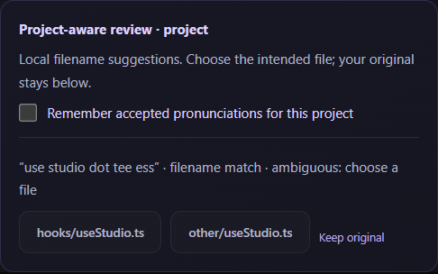
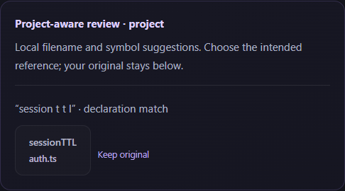

# Project-aware dictation

Mira can suggest actual project filenames and declaration names when a spoken or typed instruction uses a recognizable spoken form. This reduces the work of manually looking up a reference while keeping every replacement reviewable. It is a local correction workflow, not a claim of improved speech-model accuracy.



Actual desktop build with a synthetic instruction and test project.

## Use it

1. Connect a local project in the workspace.
2. Enable **Project-aware dictation**. Connecting a folder for attachments alone does not enable it.
3. Record or type an instruction such as “Fix use studio dot tee ess, but do not change session ownership.”
4. Prepare the instruction. If `hooks/useStudio.ts` is indexed, the review panel offers that filename. If multiple files match, choose the intended path.
5. Select a filename to replace only that occurrence, or choose **Keep original**. Nothing is changed automatically.
6. Optionally check **Remember accepted pronunciations for this project** before accepting. This explicitly saves the phrase-to-file mapping on your device.
7. Use **Undo last correction** to restore the previous draft text. Undo does not delete an explicitly saved pronunciation; remove it in the project panel if needed.
8. After manual draft edits, choose **Refresh term suggestions** to recalculate. Copy and paste always use your reviewed draft, including manual edits.

Your original transcript remains available in both Dictate and Refine. The changed-detail warning looks for original technical references, numbers, and negation that may be missing from the edited version. It is conservative, can flag intentional changes, and does not prove that the meaning was preserved.

## Declaration suggestions

With vocabulary enabled, explicitly attach a JavaScript or TypeScript file to supply declaration names. For example, `export const sessionTTL = 300` can suggest `sessionTTL` for “session t t l.” Each symbol choice shows its source file. Nothing else in the repository is read, and no declaration vocabulary is sent to the refinement provider.



The Babel parser extracts top-level functions, classes, simple variables, interfaces, type aliases, and enums from supported JS/TS/JSX/TSX snapshots, including `.mjs`, `.cjs`, `.mts`, and `.cts`. Comments, strings, imports, nested declarations, class members, and destructured bindings do not provide names. Invalid or unsupported syntax supplies no hints. Up to 200 ASCII declaration names per attached file are considered; one-word forms are omitted to avoid ordinary-word replacements. This is not a language-server semantic index.

Saved pronunciations currently map to filenames only. A symbol correction does not save an alias even when the filename-memory checkbox is checked. Changed attached content must be reattached and prepared again before a symbol suggestion can be applied.

## Manage pronunciations

Open **Project pronunciations** while vocabulary is enabled. Enter a short spoken phrase, search for an indexed file, choose it, and save. Each project supports up to 200 saved phrases. An existing phrase can be edited or removed. Saving the same normalized phrase updates its target.

For example, map “my recorder” to `hooks/useStudio.ts`. That creates a suggestion on later drafts; it does not automatically substitute the phrase. An explicit saved mapping disambiguates that phrase even if several files share a basename.

Disconnecting disables suggestions and clears the active alias list from the project panel. Saved aliases remain on disk for that folder. Reconnect and explicitly enable vocabulary to load or remove them. Moving the project to a different canonical path creates a separate scope. Use **Refresh index** after adding or renaming files; this version has no live file watcher. Refresh preserves the vocabulary toggle and saved aliases but clears attachments and their declaration hints. Reattach files and prepare a new draft to use current content.

## Matching and boundaries

- Vocabulary comes only from the existing bounded filename index, saved pronunciations, and explicitly attached JS/TS snapshots. No additional source contents are read for vocabulary.
- Filename forms split camel case, acronyms, snake case, and kebab case. Common extensions support spelled forms such as “t s,” “tee ess,” and “dot ts.”
- Filename-derived matches require at least two tokens to avoid suggesting a file for every ordinary single word. Explicit aliases may be single words.
- Matching is deterministic and exact after normalization. It does not perform general phonetic or fuzzy matching and will miss many speech errors.
- Suggestions do not cross newlines, sentence punctuation, or path separators. Already exact filenames are left alone.
- Each draft shows at most 20 suggestions and at most eight candidates per suggestion. Extremely ambiguous matches are omitted rather than selecting an arbitrary subset.
- Suggestions are tied to draft text and checked again in the main process. Modified/stale IDs, unoffered targets, deleted or redirected files, changed symbol-source snapshots, and corrections from a disconnected or different project are rejected.
- A session snapshots vocabulary at its start. Enable or edit vocabulary before starting the next recording or preparing a new draft.

In Refine mode, the original instruction is sent to the selected provider before local term review. Mira does not upload the filename index or alias store. A correction you later copy or paste shares the selected filename with that destination, just like any manually edited prompt.

## Privacy

Matching and vocabulary storage are local. Only explicitly saved aliases persist: a normalized spoken phrase and its relative filename in a versioned JSON document under the app profile. The scope filename is a hash of the canonical project path. Alias data is not encrypted, and a path hash is not an anonymity guarantee. Do not enter secrets in spoken aliases.

Writes are atomic and serialized. Corrupt or unsupported alias files fail closed without being overwritten. No transcript history, model training, automatic vocabulary upload, or correction analytics is added. See [PRIVACY.md](../PRIVACY.md).

## Verify and evaluate

Unit tests cover spoken forms, ambiguity, explicit alias precedence, exact-name preservation, occurrence offsets, limits, project isolation, persistence, and corruption handling. The Electron test exercises opt-in, acceptance, undo, aliases, changed-negation warnings, reconnect behavior, and stale/forged correction rejection.

```bash
npm run check
npm run format:check
npm run test:e2e
```

These tests establish deterministic behavior, not real-world accuracy or ROI. A user pilot should compare baseline dictation and project-aware review on equivalent developer tasks. Measure correction time, wrong identifiers, lost constraints, false suggestions, and repeated voluntary use. Evaluate held-out, consented speech across the intended microphones, accents, and hardware before publishing improvement claims.
